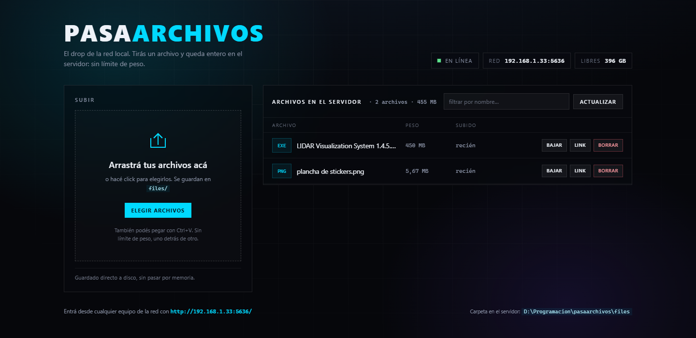

# PASAARCHIVOS

**El drop de archivos de la red local.** Arrastrás un archivo en el navegador y queda entero en el servidor. Los bajás desde cualquier otra máquina de la red con un link. Sin límite de peso, sin base de datos, sin cuenta, y **sin una sola dependencia**: `node server.js` y listo.




---

## Qué es

Una app de una sola carpeta que convierte cualquier PC con Node instalado en un punto de intercambio de archivos para la LAN: se sube desde el navegador de una máquina y se baja desde el de cualquier otra. No hay cliente que instalar, no hay servidor web que configurar y no hay nada que compilar.

## Qué hace

### Subir

- **Arrastrar y soltar** archivos sobre la zona de subida.
- **Elegir archivos** con el selector del sistema, o **pegar con `Ctrl+V`** (sirve para capturas de pantalla y archivos copiados en el explorador).
- **Sin límite de peso**: cada byte se escribe directo a disco mientras llega, nunca se carga el archivo en memoria. Un `.exe` de 450 MB o un backup de 200 GB son lo mismo para el servidor.
- **Cola de a uno**: si tirás diez archivos, se suben de a uno, en orden, sin saturar la red ni el disco.
- **Progreso y velocidad en vivo**, con botón para cancelar cada subida.
- **Nunca pisa un archivo**: si el nombre ya existe agrega ` (1)`, ` (2)`, etc.
- **Subidas cortadas**: si se cae la conexión a mitad de camino, el temporal se borra solo y no ensucia la carpeta.
- **Nombres seguros**: UTF-8 respetado, caracteres inválidos de Windows (`\ / : * ? " < > |`) saneados y nombres reservados (`CON`, `PRN`, `AUX`, `COM1`…) esquivados.
- Aviso antes de cerrar la pestaña si hay una subida en curso.

### Bajar

- **Link directo** por archivo: `/d/<nombre>`, listo para pegar en otra máquina, en un chat o en un `curl`.
- **Descargas reanudables**: soporta `Range`, así que se puede retomar una descarga cortada con el navegador o con `curl -C -`.
- **Siempre como adjunto**, con el nombre original (incluido `filename*=UTF-8''` para acentos y caracteres no ASCII).
- Botón **Link** que copia la URL absoluta al portapapeles.

### Gestionar

- Lista de archivos con **peso** y **antigüedad** ("recién", "hace 12 min", fecha completa en el tooltip).
- **Filtro** por nombre en vivo.
- **Borrar con doble click** (sin diálogos nativos del navegador: el botón se transforma en "¿Seguro?" por 4 segundos).
- **Auto-refresco cada 8 segundos**: si otro equipo sube algo, aparece solo en todas las pestañas abiertas.
- Chips de estado: servidor en línea, **IP:puerto reales** de la LAN, y **espacio libre** del disco del servidor.
- La página muestra siempre la carpeta física donde están guardados los archivos.

### Arrancar

- `iniciar_pasaarchivos.bat`: doble click, levanta el servidor y **abre el navegador solo**. Si ya está corriendo, no duplica el proceso, solo abre la pestaña.
- `instalar_al_inicio.bat`: crea un acceso en la carpeta **Inicio** de Windows para que arranque solo al iniciar sesión (se desactiva borrando el acceso).
- Puerto configurable con la variable de entorno `PORT` (por defecto **5636**).

---

## Por qué no hay `node_modules` (ni `npm install`)

Porque **no hay ninguna dependencia externa**. `server.js` usa únicamente módulos que ya vienen adentro de Node:

| Módulo | Para qué |
|---|---|
| `http` | el servidor HTTP, sin Express ni framework alguno |
| `fs` / `fs.promises` | escribir, leer, renombrar y borrar archivos |
| `path` | armar rutas y validar que nadie se escape de la carpeta |
| `os` | leer las interfaces de red para detectar la IP de la LAN |
| `crypto` | nombre aleatorio (`randomUUID`) para los temporales de subida |
| `stream/promises` | `pipeline(req, archivo)` para volcar el cuerpo a disco |
| `url` | parsear query strings y paths de cada request |

Todos son módulos nativos (`node:*`), estables desde hace varias versiones de Node. Por eso:

- **no hay `node_modules/`** → no hay nada que instalar,
- **no hay `package-lock.json`** → no hay árbol de dependencias que actualizar ni auditar,
- **no hay build** → no hay transpilador, bundler ni paso de compilación,
- **no hay `npm install`** → clonás el repo, corrés `node server.js` y funciona.

El `package.json` existe solo para declarar el nombre, la versión mínima de Node (`engines`) y el atajo `npm start`. Tiene **cero** `dependencies` y **cero** `devDependencies`: si lo abrís, lo vas a ver vacío de dependencias.

## Qué es `public/`

Es el **frontend**, y lo sirve el mismo proceso Node (no hace falta Apache, nginx ni un servidor aparte). Son tres archivos planos, sin framework y sin bundler:

```
public/
├─ index.html   estructura y textos
├─ styles.css   estilos (tema oscuro FSC)
└─ app.js       lógica: fetch de la lista, XHR con progreso, drag & drop, portapapeles
```

El servidor los entrega desde `serveStatic()` con su `Content-Type` correcto, `Cache-Control: no-cache` y protección contra *path traversal* (`../`, rutas absolutas, null bytes). Editás un archivo, recargás la página, y ves el cambio: no hay paso de build que esperar.

La comunicación es por JSON contra la misma máquina:

- `app.js` pide la lista a `GET /api/files` y se redibuja solo si la firma (`nombre:peso:mtime`) cambió.
- Las subidas van con `XMLHttpRequest` para poder mostrar progreso real (un `fetch` no reporta el avance del envío).
- Los borrados y las subidas mandan el header `X-Pasaarchivos: 1`, que el servidor exige como mínimo filtro anti-CSRF.

---

## Requisitos

- **Node.js 18.15 o superior** (usa `fs.promises.statfs` para leer el espacio libre; probado en Node 24).
- Windows, Linux o macOS.
- Nada más. Ni base de datos, ni variables de entorno obligatorias, ni servicios externos.

## Arrancar

**Windows (lo normal):**

```
doble click en iniciar_pasaarchivos.bat
```

**Cualquier sistema:**

```bash
node server.js
# o
npm start
# otro puerto
PORT=8080 node server.js
```

La consola imprime las dos URLs:

```
  PASAARCHIVOS ------------------------------------------
  Carpeta de archivos : D:\Programacion\pasaarchivos\files
  En esta máquina     : http://localhost:5636/
  En la red local     : http://192.168.1.33:5636/
  Sin límite de peso. Ctrl+C para detener.
```

Desde otro equipo de la red se entra con la segunda. La IP puede cambiar por DHCP: la página siempre muestra la real en el chip **RED** y en el pie, así que no hay que memorizarla.

## Estructura

```
pasaarchivos/
├─ server.js                 servidor HTTP completo (solo módulos nativos de Node)
├─ package.json              sin dependencias: solo nombre, engines y npm start
├─ public/                   interfaz
│  ├─ index.html
│  ├─ styles.css
│  └─ app.js
├─ files/                    acá quedan los archivos subidos
│  └─ .tmp/                  temporales de subidas en curso (se borran solos)
├─ docs/
│  └─ pasaarchivos.png       captura
├─ iniciar_pasaarchivos.bat  launcher para Windows
└─ instalar_al_inicio.bat    arranque automático con Windows
```

La carpeta `files/` está en `.gitignore`: los archivos subidos viven en la máquina, nunca en el repo. El servidor la crea sola al arrancar si no existe.

## Cómo funciona por dentro

1. El navegador manda `PUT /api/upload?name=<archivo>` con el archivo crudo como cuerpo.
2. El servidor lo escribe en `files/.tmp/<uuid>.part` con `pipeline(req, writeStream)`: **streaming puro, memoria constante**, sin importar el tamaño.
3. Al terminar, `commitFile()` lo mueve a `files/<nombre>` con `link()` (atómico y sin pisar): si el nombre ya existe, prueba ` (1)`, ` (2)`… hasta encontrar uno libre. Si el filesystem no soporta hard links, cae a `copyFile` con `COPYFILE_EXCL`.
4. Verifica que hayan llegado exactamente los bytes declarados en `Content-Length`; si no, descarta el temporal y responde error.
5. La lista se refresca sola cada 8 segundos en todas las máquinas abiertas.
6. `GET /d/<nombre>` descarga con `Content-Disposition: attachment` y `Accept-Ranges: bytes`; acepta `bytes=a-b` y rangos sufijo (`bytes=-500`), y responde `416` si el rango es inválido.

### Endpoints

| Método | Ruta | Qué hace |
|---|---|---|
| `GET` | `/` | interfaz (`public/index.html`) |
| `GET` | `/api/info` | nombre, IP, puerto, carpeta, disco, totales |
| `GET` | `/api/files` | lista de archivos + espacio libre |
| `PUT`/`POST` | `/api/upload?name=<nombre>` | sube un archivo (requiere header `X-Pasaarchivos: 1`) |
| `DELETE` | `/api/files/<nombre>` | borra un archivo (requiere header `X-Pasaarchivos: 1`) |
| `GET`/`HEAD` | `/d/<nombre>` | descarga, con soporte de `Range` |
| `GET` | `/styles.css`, `/app.js` | estáticos del frontend |

## API (para scripts)

```bash
# subir
curl -X PUT -H "X-Pasaarchivos: 1" --data-binary @archivo.zip \
  "http://192.168.1.33:5636/api/upload?name=archivo.zip"

# listar
curl -s http://192.168.1.33:5636/api/files | python -m json.tool

# bajar (con el nombre original)
curl -O -J http://192.168.1.33:5636/d/archivo.zip

# reanudar una descarga cortada
curl -C - -O http://192.168.1.33:5636/d/archivo.zip

# borrar
curl -X DELETE -H "X-Pasaarchivos: 1" \
  "http://192.168.1.33:5636/api/files/archivo.zip"
```

## Detalles de implementación que importan

- **Sin timeouts de cuerpo**: `requestTimeout = 0` y `timeout = 0`. Una subida de horas no se corta sola; el `keepAliveTimeout` queda en 72 s para las conexiones ociosas.
- **Backpressure real**: `pipeline()` conecta el socket de entrada con el archivo y frena la lectura si el disco no da abasto. Nunca hay un buffer gigante en RAM.
- **Escritura atómica**: el `.part` + `link()` evita que aparezca en la lista un archivo a medio escribir y resuelve las carreras de nombres sin locks.
- **499 cuando el cliente corta**: se responde `499` (convención de nginx) en vez de un 500 genérico, y se limpia el temporal.
- **Path traversal cerrado**: tanto `/d/<nombre>` como los estáticos validan `basename`, rechazan `..`, barras, rutas absolutas y nombres que empiezan con punto; además comparan el path resuelto contra el directorio base.
- **Nombres con acentos**: `contentDisposition()` arma `filename="ascii"` + `filename*=UTF-8''…` para que el archivo llegue con el nombre correcto en cualquier navegador.
- **Detección de IP LAN**: recorre `os.networkInterfaces()`, descarta loopback y `169.254.x`, y prioriza `192.168.x` > `10.x` > `172.16–31.x`, sumando puntos si el adaptador parece Wi-Fi.
- **Espacio en disco**: `fs.promises.statfs()` sobre `files/`; si el filesystem no lo soporta, el chip muestra `—` y todo sigue funcionando.
- **UI sin diálogos nativos**: nada de `alert`/`confirm`/`prompt`. El borrado se confirma con doble click y todos los avisos van a una línea de estado.

## Seguridad

Pensado **para la red local, sin login a propósito**. Cualquiera en la misma red puede subir, bajar y borrar. No lo expongas a internet tal cual: si lo necesitás desde afuera, ponelo detrás de una VPN (Tailscale, WireGuard) o agregale autenticación y HTTPS.

## Notas

- Si otro equipo no conecta: revisar el **Firewall de Windows** (permitir Node.js en redes privadas) y que ambos estén en la misma subred.
- Arrancar dos veces el servidor no duplica nada: la segunda instancia detecta `EADDRINUSE` y sale con un mensaje claro. El `.bat` además chequea el puerto antes de lanzar Node.
- La consola registra cada subida y descarga con peso y velocidad, y cada borrado.

---

Hecho por [Julián Puppo (JPupper)](https://fullscreencode.com) · Fullscreen Code
